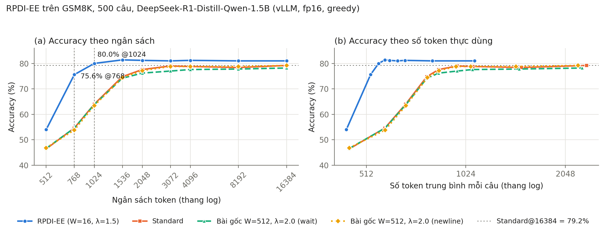

# Báo cáo thí nghiệm: RPDI-EE ở ngân sách hẹp so với cấu hình bài gốc ở 16384 token (500 câu GSM8K)

> Ngày chạy: 05/11/2026 · Môi trường: Google Colab, Tesla T4, float16, vLLM 0.6.3.post1 · Phân tích: `method_c_rpdi_ee/vllm_engine/analyze_budgets.py` (bảng chính) và `method_c_rpdi_ee/vllm_engine/deep_dive.py` (phân tích sâu)
>
> Dữ liệu gốc: `results/gsm8k_500/raw.jsonl`, `results/gsm8k_500/budgets.jsonl` · Bảng tự động: `results/gsm8k_500/analysis.md` · Phân tích sâu: `results/gsm8k_500/deep_dive.json` · Hình: `report/gsm8k_500_accuracy_vs_budget.png`

## Tóm tắt

1. **Ở 1024 token, RPDI-EE (W=16, λ=1.5) không kém cấu hình bài gốc (W=512, λ=2.0) ở 16384 token.**
   - Accuracy: 80.0%, so với 78.2–79.2% của bài gốc và 79.2% của Standard ở 16384 token.
   - Cận dưới KTC 95% của chênh lệch là −1.2 đến −2.2 điểm, nằm trên biên −δ = −3 điểm.
   - Số token trung bình chỉ bằng 23–25% (558 so với 2239–2377).
   - Standard không đạt 80.0% ở bất kỳ ngân sách nào, kể cả 16384 token.
2. **Ở 768 token, RPDI-EE thấp hơn 2.6–3.6 điểm** (75.6% so với 78.2–79.2%). So với Standard và biến thể newline, kết luận là "kém hơn, chưa chứng minh nằm trong δ". So với biến thể wait thì chưa kết luận được. Đổi lại, phương pháp lấy lại được 85–89% khoảng cách accuracy với mức 16k mà chỉ dùng khoảng 22% số token.
3. **So với Standard cùng ngân sách, mức tăng rất lớn:** +21.0 điểm ở 768 token và +16.0 điểm ở 1024 token (McNemar p ≈ 4×10⁻²¹ và 1×10⁻¹⁵).
4. **Cấu hình bài gốc không phanh lần nào trên 500 câu.** Giá trị RPDI lớn nhất với W=512, tính ở mọi vị trí, chỉ đạt 1.58. Như vậy trên GSM8K, "RPDI-EE theo bài gốc ở 16k" thực chất là sinh tự do.
5. **Khoảng cách ở 768 token chủ yếu đến từ pha trả lời bị cắt.** Trong 46 câu RPDI-EE@768 sai mà Standard@16384 đúng, có 32 câu đã phanh nhưng lời giải bị cắt ở 768 token. Lên 1024 token, số câu bị cắt giảm còn 11.
6. **Pipeline lặp lại tốt.** 200 câu trùng với lần chạy thử cho output giống hệt ở 96–99% số lượt, và accuracy lệch không quá 1 điểm.

## 1. Mục tiêu

Câu hỏi nghiên cứu (Mục 4.8.4, chương 4):

> Với ngân sách hẹp (768 hoặc 1024 token), RPDI-EE với cấu hình của đề tài (W=16, λ=1.5) đạt độ chính xác **hơn, tương đương hay kém hơn** cấu hình của bài gốc (W=512, λ=2.0) ở 16384 token, trên cùng mô hình, cùng prompt và cùng tập câu?

Lần chạy này mở rộng lần chạy thử 200 câu (`bao_cao_pilot_vllm_200.md`) lên 500 câu để thu hẹp khoảng tin cậy.

## 2. Thiết lập

| Thành phần | Giá trị |
| :--- | :--- |
| Mô hình | `deepseek-ai/DeepSeek-R1-Distill-Qwen-1.5B` |
| Dữ liệu | 500 câu GSM8K test, id 100–599. Không trùng 100 câu id 0–99 đã dùng để chọn W, λ. |
| Prompt | `User: {câu hỏi}\nAssistant: <think>`, giống các thí nghiệm HF |
| Giải mã | Greedy (temperature = 0) |
| Ngân sách | Sinh một lần ở 16384 token, rồi suy ra các mức 512 → 16384 bằng cách cắt chuỗi token |
| Phần cứng | Tesla T4, float16. Trọng số gốc ở bf16 được ép sang fp16, vì T4 không hỗ trợ bf16. |
| Phần mềm | vLLM 0.6.3.post1 (engine V0), torch 2.4.0, transformers 4.46.3 |
| Code | `method_c_rpdi_ee/vllm_engine/`, notebook `rpdi_vllm_colab.ipynb` |
| Biên δ | 3 điểm, chốt trước khi chạy |

Bốn phương pháp được so sánh:

| Phương pháp | Mô tả | Vai trò |
| :--- | :--- | :--- |
| `standard` | Sinh tự do, không can thiệp. Tương ứng "Vanilla" của bài gốc. | Baseline |
| `rpdi_legacy_W16_l1.5` | Cấu hình của đề tài: W=16, λ=1.5, phanh ở dấu câu, ép chuỗi `</think>\n`. Bản sao chính xác của bản HF. | Phương pháp nghiên cứu |
| `rpdi_W512_l2.0_wait` | Algorithm 1 của bài gốc, W=512, λ=2.0, phanh ở token "Wait" (cách hiểu theo DEER) | Cấu hình bài gốc, cách hiểu 1 |
| `rpdi_W512_l2.0_newline` | Như trên, phanh ở token xuống dòng | Cấu hình bài gốc, cách hiểu 2 |

**Bài gốc không công bố mã nguồn.** Hai biến thể `paper` được cài theo Algorithm 1 của bài báo, với tập biên lấy theo DEER (cùng nhóm tác giả).

**Toàn bộ 500 câu được sinh trong cùng một lần chạy.** Notebook định chép kết quả 200 câu cũ để bỏ qua, nhưng log ghi `đã có 0`, nghĩa là cả 2000 lượt đã được sinh lại. Điều này không ảnh hưởng kết quả, và còn cho phép đo độ lặp lại của pipeline (Mục 3.4).

**Thống kê.** Chênh lệch accuracy được tính theo cặp (cùng câu hỏi), kèm KTC bootstrap 90% và 95% (10000 lần lặp) và kiểm định McNemar chính xác. Các so sánh với mốc 16384 token lấy từ `analysis.md`. Các so sánh bổ sung lấy từ `deep_dive.json`. Hai script dùng chuỗi ngẫu nhiên khác nhau, nên cận KTC có thể lệch nhau khoảng ±0.2 điểm.

## 3. Độ tin cậy của pipeline

### 3.1. So với HF ở 768 token

Bước kiểm tra này dùng lại kết quả HF trên 200 câu, nên kết quả giống lần chạy thử: **không đạt** ngưỡng 2 điểm (Standard +2.5, RPDI-EE +4.5). Nguyên nhân là hai bên khác kiểu số (HF bf16, vLLM fp16), không phải lỗi pipeline (xem `bao_cao_pilot_vllm_200.md`, Mục 3.1). Mọi so sánh chính trong báo cáo này đều nằm trong cùng pipeline vLLM fp16.

### 3.2. Kiểm tra nội bộ

- **Phần sinh ra trước điểm phanh** của RPDI-EE giống hệt Standard ở **300/305** câu có phanh. Logits processor không làm thay đổi quỹ đạo trước khi phanh.
- Việc phát lại bộ giám sát trên entropy đã ghi (khớp 128/128 ở lần chạy thử) chưa được làm lại cho 500 câu, vì máy local không có tokenizer.

### 3.3. Nhiễu nền của vLLM

Hai chế độ `paper` không phanh lần nào, nên về thuật toán chúng giống hệt `standard`. Dù vậy:

| Phương pháp | Output giống hệt `standard` | Vị trí khác đầu tiên (trung vị) | Chỉ PP đúng / chỉ Standard đúng @768 | @16384 |
| :--- | ---: | ---: | :---: | :---: |
| `rpdi_W512_l2.0_wait` | 425/500 | token 397 | 4 / 4 | 3 / 8 |
| `rpdi_W512_l2.0_newline` | 419/500 | token 417 | 3 / 7 | 7 / 7 |

Như vậy mức 78.2% của biến thể wait so với 79.2% của Standard ở 16384 token **chỉ là nhiễu**. Ba mốc tham chiếu ở 16384 token là cùng một thuật toán và không được tính là ba bằng chứng độc lập.

### 3.4. Độ lặp lại so với lần chạy thử

200 câu id 100–299 có trong cả hai lần chạy (cùng code, cùng GPU T4, khác phiên Colab):

| Phương pháp | Output giống hệt | Acc @768 (mới / cũ) | @1024 | @16384 |
| :--- | ---: | :---: | :---: | :---: |
| `standard` | 192/200 | 55.0 / 55.0 | 63.5 / 64.0 | 81.5 / 82.0 |
| `rpdi_legacy_W16_l1.5` | 198/200 | 76.0 / 76.0 | 80.5 / 80.5 | 81.5 / 82.0 |
| `rpdi_W512_l2.0_wait` | 193/200 | 55.5 / 56.0 | 63.5 / 64.5 | 79.0 / 80.0 |
| `rpdi_W512_l2.0_newline` | 194/200 | 55.0 / 55.0 | 62.5 / 62.5 | 81.0 / 81.5 |

Accuracy lệch tối đa 1 điểm giữa hai lần chạy. Pipeline cho kết quả ổn định.

## 4. Kết quả

### 4.1. Accuracy theo ngân sách

Accuracy % (số token trung bình trong ngoặc):

| Phương pháp | 512 | 768 | 1024 | 1536 | 2048 | 3072 | 4096 | 8192 | 16384 |
| :--- | ---: | ---: | ---: | ---: | ---: | ---: | ---: | ---: | ---: |
| `standard` | 46.4 (455) | 54.6 (583) | 64.0 (673) | 74.8 (780) | 77.6 (848) | 79.0 (964) | 78.8 (1075) | 78.4 (1509) | 79.2 (2377) |
| `rpdi_legacy_W16_l1.5` | **54.0** (445) | **75.6** (527) | **80.0** (558) | **81.4** (583) | 81.2 (601) | 81.0 (636) | 81.2 (671) | 81.0 (810) | 81.0 (1089) |
| `rpdi_W512_l2.0_wait` | 46.6 (455) | 54.6 (584) | 63.8 (674) | 74.2 (781) | 76.2 (848) | 77.0 (964) | 77.6 (1073) | 77.8 (1485) | 78.2 (2304) |
| `rpdi_W512_l2.0_newline` | 46.8 (455) | 53.8 (583) | 63.4 (674) | 74.4 (784) | 77.2 (850) | 78.8 (957) | 78.8 (1059) | 78.8 (1452) | 79.2 (2239) |

Tỷ lệ câu cạn ngân sách %:

| Phương pháp | 512 | 768 | 1024 | 1536 | 2048 | 3072 | 4096 | 8192 | 16384 |
| :--- | ---: | ---: | ---: | ---: | ---: | ---: | ---: | ---: | ---: |
| `standard` | 59.4 | 43.2 | 28.0 | 15.2 | 11.8 | 11.0 | 10.6 | 10.6 | 10.6 |
| `rpdi_legacy_W16_l1.5` | 51.8 | 18.4 | 7.4 | 4.2 | 3.4 | 3.4 | 3.4 | 3.4 | 3.4 |
| `rpdi_W512_l2.0_wait` | 59.6 | 43.2 | 28.2 | 15.0 | 11.8 | 11.0 | 10.2 | 10.0 | 10.0 |
| `rpdi_W512_l2.0_newline` | 59.6 | 43.0 | 28.8 | 15.2 | 11.2 | 10.2 | 9.6 | 9.6 | 9.6 |

Tỷ lệ phanh trong pha suy nghĩ: `legacy` phanh 60.4% số câu ở 512 token và 61.0% từ 1024 token trở lên. Hai chế độ `paper` phanh 0% ở mọi ngân sách.

Nhận xét:

- **`legacy` bão hòa từ 1024 token.** Accuracy đạt 80.0% ở 1024 và dao động 81.0–81.4% từ 1536 trở lên. Số token trung bình chỉ tăng chậm (558 → 1089).
- **Hai chế độ `paper` trùng với `standard`** ở mọi ngân sách, chênh lệch nằm trong mức nhiễu (Mục 3.3).

### 4.2. So sánh chính (δ = 3 điểm)

| Target | Reference | Acc T | Acc R | Δ (T−R) | KTC 95% | KTC 90% | McNemar p | Token T/R | Kết luận |
| :--- | :--- | ---: | ---: | ---: | :---: | :---: | ---: | ---: | :--- |
| `legacy@768` | `standard@768` | 75.6 | 54.6 | **+21.0** | [+16.8, +25.2] | – | 4×10⁻²¹ | 0.90 | Hơn |
| `legacy@1024` | `standard@1024` | 80.0 | 64.0 | **+16.0** | [+12.2, +19.8] | – | 1×10⁻¹⁵ | 0.83 | Hơn |
| `legacy@768` | `standard@16384` | 75.6 | 79.2 | −3.6 | [−7.0, −0.4] | [−6.4, −0.8] | 0.047 | 0.22 | Kém hơn, chưa chứng minh trong δ |
| `legacy@768` | `paper_wait@16384` | 75.6 | 78.2 | −2.6 | [−6.0, +0.6] | [−5.4, +0.2] | 0.16 | 0.23 | Chưa kết luận |
| `legacy@768` | `paper_newline@16384` | 75.6 | 79.2 | −3.6 | [−7.0, −0.4] | [−6.4, −0.8] | 0.044 | 0.24 | Kém hơn, chưa chứng minh trong δ |
| `legacy@1024` | `standard@16384` | 80.0 | 79.2 | **+0.8** | [−2.2, +3.8] | [−1.8, +3.4] | 0.70 | 0.23 | **Không kém hơn quá δ** |
| `legacy@1024` | `paper_wait@16384` | 80.0 | 78.2 | **+1.8** | [−1.2, +4.8] | [−0.8, +4.4] | 0.31 | 0.24 | **Không kém hơn quá δ** |
| `legacy@1024` | `paper_newline@16384` | 80.0 | 79.2 | **+0.8** | [−2.2, +3.8] | [−1.8, +3.4] | 0.70 | 0.25 | **Không kém hơn quá δ** |
| `legacy@16384` | `standard@16384` | 81.0 | 79.2 | +1.8 | [−1.0, +4.6] | [−0.6, +4.2] | 0.27 | 0.46 | Không kém hơn quá δ |

Cách đọc các kết luận ở 1024 token:

- **"Không kém hơn" không có nghĩa là "tốt hơn".** Δ dương nhưng McNemar p = 0.3–0.7.
- **Chưa đạt "tương đương" theo TOST**, vì cận trên KTC 90% (+3.4 đến +4.4) vượt +δ. Nói cách khác, khả năng RPDI-EE tốt hơn bài gốc hơn 3 điểm chưa bị loại trừ. Đây là chiều không bất lợi cho phương pháp.

### 4.3. Ba góc nhìn cho RPDI-EE ở ngân sách hẹp

| Góc nhìn | @768 | @1024 |
| :--- | :--- | :--- |
| Cùng ngân sách | +21.0 điểm so với Standard | +16.0 điểm so với Standard |
| Cùng accuracy | Standard cần ngân sách **2048** (77.6%, trung bình 848 token) để vượt 75.6%. RPDI-EE dùng trung bình 527 token. | Standard **không đạt 80.0% ở bất kỳ ngân sách nào** (tối đa 79.2%) |
| So với 16384 token | −3.6 điểm, 22% số token. Phục hồi 85% (89% so với biến thể wait). | +0.8 điểm, 23% số token. Phục hồi 105%. |

*Phục hồi* = (Acc RPDI@B − Acc Standard@B) / (Acc tham chiếu@16384 − Acc Standard@B).

### 4.4. Vì sao cấu hình bài gốc không phanh

Tính RPDI với cửa sổ W ở **mọi vị trí** trong chuỗi suy nghĩ của `standard`, không xét tập biên. Đây là cận trên của khả năng phanh.

| W | Số câu có chuỗi suy nghĩ ≥ W | RPDI max (toàn bộ) | P90 của RPDI max mỗi câu | Số câu max > 1.3 | > 1.5 | > 2.0 |
| --: | ---: | ---: | ---: | ---: | ---: | ---: |
| 512 | 228 | **1.58** | 1.34 | 34 | 1 | **0** |
| 256 | 262 | 2.01 | 1.64 | 127 | 51 | 1 |
| 128 | 412 | 2.61 | 1.88 | 208 | 147 | 25 |

- Với W=512, **không có vị trí nào vượt λ=2.0**, nên chọn tập biên nào cũng không phanh. Việc bài gốc không nói rõ tập biên (wait hay newline) không ảnh hưởng kết quả ở đây.
- Nguyên nhân là chuỗi suy nghĩ trên GSM8K ngắn so với cửa sổ. Độ dài chuỗi suy nghĩ của `standard` có P25 = 147, **trung vị = 294**, P75 = 860 token. Chỉ 227/500 câu suy nghĩ đủ 512 token. Với các câu đủ dài, cửa sổ 512 token phủ phần lớn chuỗi, nên LTF ≈ GTF và RPDI ≈ 1.
- Kết quả này phù hợp với bài gốc: Hình 5 của bài gốc báo tỷ lệ kích hoạt trên GSM8K chỉ 2.0% (đo trên các mô hình lớn hơn).
- **Không dùng bảng này để chọn W, λ**, vì id 100–599 là tập kiểm tra.

### 4.5. Phân tích các câu RPDI-EE sai nhưng Standard@16384 đúng

| Nhóm | @768: số câu | Đúng nếu RPDI-EE có 16384 token | @1024: số câu | Đúng nếu có 16384 token |
| :--- | ---: | ---: | ---: | ---: |
| Đã phanh, lời giải bị cắt do hết ngân sách | **32** | 22 | 11 | 7 |
| Đã phanh, viết xong lời giải nhưng sai | 12 | 0 | **17** | 0 |
| Chưa phanh, bị cắt do hết ngân sách | 2 | 2 | 0 | – |
| **Tổng câu mất** | **46** | | **28** | |
| Chiều ngược lại: RPDI-EE đúng, Standard@16384 sai | 28 | | 32 | |

- **Ở 768 token, khoảng cách chủ yếu do pha trả lời thiếu chỗ** (32/46 câu), không phải do tín hiệu phanh. Có 22 trong 32 câu này sẽ đúng nếu pha trả lời có đủ token.
- **Thêm 256 token (768 → 1024) gần như xóa được nhóm bị cắt** (32 → 11). Phần còn lại chủ yếu là câu phanh xong nhưng giải sai (17 câu). Nhóm này mới phản ánh giới hạn thật của tín hiệu phanh: phanh có thể quá sớm, hoặc mô hình sai dù có phanh hay không.

### 4.6. Phanh làm hỏng câu Standard làm đúng (cùng ngân sách)

| Ngân sách | Standard đúng, RPDI-EE sai | Trong đó đã phanh | Trong đó lời giải bị cắt |
| ---: | ---: | ---: | ---: |
| 768 | 16 | 16 | 9 |
| 1024 | 14 | 14 | 1 |
| 16384 | 22 | 22 | 3 |

Mọi câu bị hỏng đều là câu đã phanh. Ở 1024 và 16384 token, phần lớn không phải do bị cắt, nên đây là chi phí thật của việc phanh. Chi phí này nhỏ so với lợi ích: ở 1024 token, RPDI-EE cứu 94 câu và làm hỏng 14 câu.

### 4.7. Hành vi phanh của RPDI-EE

- Phanh **305/500 câu (61.0%)**.
- Vị trí phanh (số token suy nghĩ): nhỏ nhất 29, P10 = 56, P25 = 75, **trung vị 100**, P75 = 141, P90 = 221, lớn nhất 802.
- Độ dài pha trả lời sau khi phanh, đo ở 16384 token: P10 = 230, P25 = 356, **trung vị 499**, P75 = 697, P90 = 939.
- 17 câu (3.4%) phanh xong rồi lặp trong pha trả lời đến hết 16384 token.

Câu phanh ở vị trí trung vị (100 token) còn khoảng 668 token cho pha trả lời trong ngân sách 768. Mức này ít hơn P75 của độ dài pha trả lời (697), nên 89/304 câu đã phanh (29%) bị cắt ở 768 token. Ở 1024 token còn khoảng 924 token, gần bằng P90, và chỉ 37/305 câu đã phanh (12%) bị cắt.

### 4.8. Ở ngân sách lớn: lợi thế giảm dần nhưng không mất

| Ngân sách | RPDI-EE | Standard | Chỉ RPDI-EE đúng | Chỉ Standard đúng |
| ---: | ---: | ---: | ---: | ---: |
| 512 | 54.0 | 46.4 | 71 | 33 |
| 768 | 75.6 | 54.6 | 121 | 16 |
| 1024 | 80.0 | 64.0 | 94 | 14 |
| 1536 | 81.4 | 74.8 | 51 | 18 |
| 2048 | 81.2 | 77.6 | 38 | 20 |
| 4096 | 81.2 | 78.8 | 34 | 22 |
| 16384 | 81.0 | 79.2 | 31 | 22 |

Ở 16384 token, tách theo nhóm:

| Nhóm câu (ở 16384 token) | Số câu | RPDI-EE đúng | Standard đúng | Token TB: Standard → RPDI-EE |
| :--- | ---: | ---: | ---: | :--- |
| Standard lặp đến hết 16384 token, không đóng `</think>` | 53 | **33** | 16 | 16384 → 4596 |
| Cả hai kết thúc bình thường | 443 | 83.5% | 84.9% | 710 → 531 (−25%) |

- **Riêng 53 câu lặp của Standard (10.6%) chiếm 1737 trong 2377 token trung bình.** RPDI-EE phanh cả 53 câu, 40 câu kết thúc được, và đúng 33 câu so với 16 câu của Standard (chỉ RPDI-EE đúng: 21 câu, chỉ Standard đúng: 4 câu).
- **Trên các câu bình thường, RPDI-EE tiết kiệm 25% token** nhưng kém hơn một chút (10 câu so với 16 câu, McNemar p = 0.33, không có ý nghĩa thống kê). Pha suy nghĩ giảm từ 469 xuống 139 token, nhưng pha trả lời tăng từ 241 lên 392 token: mô hình tiếp tục suy luận ngay trong lời giải.

## 5. Thảo luận

### 5.1. Trả lời câu hỏi nghiên cứu

- **Ở 1024 token: không kém hơn** cấu hình bài gốc ở 16384 token (biên δ = 3), với khoảng 1/4 số token.
- **Ở 768 token: kém hơn khoảng 3 điểm.** Kết quả này chưa chứng minh được nằm trong biên δ. Phần lớn khoảng cách đến từ pha trả lời thiếu chỗ (Mục 4.5).

Hai kết quả này không mâu thuẫn. Tín hiệu phanh giống hệt nhau ở hai ngân sách (61% số câu, cùng vị trí phanh), và thứ thay đổi chỉ là chỗ còn lại cho lời giải. **Ngưỡng ngân sách tối thiểu để RPDI-EE theo kịp mốc 16k trên GSM8K với mô hình 1.5B nằm trong khoảng 768–1024 token.**

### 5.2. Về cấu hình của bài gốc

Với W=512, λ=2.0, RPDI-EE **không kích hoạt trên GSM8K với mô hình 1.5B, kể cả ở 16384 token**. Bài gốc chọn cấu hình này bằng ablation trên mô hình 32B, với ngân sách nhỏ nhất được thử là 8192 token. Cấu hình đó không chuyển được sang bài toán có chuỗi suy nghĩ ngắn. Vì vậy, "so với bài gốc" ở đây thực chất là so với sinh tự do ở 16k.

Không suy ra được rằng phương pháp của bài gốc thất bại nói chung. Bài gốc báo mức tăng trên các nhóm gồm AMC23, MATH500 và các bộ khó hơn, nơi chuỗi suy nghĩ dài hơn nhiều. Bài gốc cũng không công bố mã nguồn, nên bản tái hiện có thể khác bản gốc ở các chi tiết không được mô tả.

### 5.3. Lợi ích ngoài ngân sách hẹp

Ở 16384 token, RPDI-EE vẫn giữ accuracy (81.0% so với 79.2%) với 46% số token. Lợi ích này gần như hoàn toàn đến từ việc **phá các vòng lặp không bao giờ đóng `</think>`** (Mục 4.8), chứ không phải từ việc rút ngắn suy luận bình thường.

### 5.4. Những điều chưa được kết luận

- **RPDI-EE tốt hơn cắt cứng:** chưa có bằng chứng trong pipeline vLLM. Ở 768 token với HF (200 câu), cắt cứng N = 130 đạt 72.0%, hòa với RPDI-EE (71.5%).
- **RPDI-EE tương đương bài gốc ở 1024 token** theo nghĩa TOST: cận trên KTC 90% vượt +δ.
- **Kết quả trên tập khác GSM8K:** chưa thử.

## 6. Hạn chế

1. **Cỡ mẫu 500 câu.** KTC 95% của chênh lệch còn rộng khoảng ±3 điểm, xấp xỉ δ.
2. **Nhiễu của vLLM** làm accuracy dao động khoảng ±1–2 điểm giữa các lượt cùng thuật toán (Mục 3.3, 3.4).
3. **Chưa có đối chứng cắt cứng và phanh ngẫu nhiên trong pipeline vLLM.**
4. **fp16 trên T4 thay vì bf16.** Bước kiểm tra so với HF (bf16) không đạt. Độ tin cậy của pipeline dựa trên các kiểm tra nội bộ (Mục 3.2–3.4).
5. **Bài gốc không có mã nguồn.** Cấu hình bài gốc là bản tái hiện theo Algorithm 1, và tập biên được suy ra từ DEER.
6. **Prompt khác bài gốc.** Đề tài dùng prompt thô, còn DEER và có lẽ cả bài gốc dùng chat template và yêu cầu `\boxed{}`. Standard@16384 ở đây (79.2%) cao hơn số DEER công bố cho 1.5B trên GSM8K (76.1%, 1319 câu).
7. **Một mô hình, một tập dữ liệu, giải mã greedy.**

## 7. Đề xuất bước tiếp theo

| Ưu tiên | Việc | Mục đích |
| :---: | :--- | :--- |
| 1 | Thêm cắt cứng (N ≈ 100–130) và phanh ngẫu nhiên vào pipeline vLLM, chạy trên cùng 500 câu | Kiểm tra lợi thế đến từ tín hiệu entropy hay chỉ từ việc rút ngắn suy nghĩ |
| 2 | Chèn "Final Answer:" ngay sau `</think>` khi phanh | Giảm nhóm 32 câu bị cắt ở 768 token |
| 3 | Mở rộng lên toàn bộ 1219 câu id 100–1318 (thêm 719 câu) | Thu hẹp KTC xuống khoảng ±2 điểm, có thể đủ để kết luận tương đương |
| 4 | Cập nhật chương 4, Mục 4.8.4, bằng kết quả của báo cáo này | Đồng bộ luận văn với số đo thật |

## 8. Cách viết vào luận văn

> Trên 500 câu GSM8K không dùng để chọn tham số, RPDI-EE (W = 16, λ = 1.5) ở ngân sách 1024 token đạt 80.0%, không kém cấu hình gốc của bài báo (W = 512, λ = 2.0) ở 16384 token (78.2–79.2%; chênh lệch +0.8 đến +1.8 điểm, cận dưới KTC 95% từ −2.2 điểm, trên biên δ = 3 điểm đã chốt trước), trong khi chỉ dùng khoảng 23–25% số token (558 so với 2239–2377). Sinh tự do không đạt mức 80.0% ở bất kỳ ngân sách nào đến 16384 token. Ở 768 token, phương pháp đạt 75.6%, thấp hơn mốc 16k từ 2.6 đến 3.6 điểm nhưng lấy lại được 85–89% khoảng cách độ chính xác; phần lớn khoảng cách còn lại (32/46 câu) đến từ lời giải bị cắt sau khi phanh. Cấu hình gốc không kích hoạt lần nào trên GSM8K với mô hình 1.5B, vì chuỗi suy nghĩ (trung vị 294 token) quá ngắn so với cửa sổ 512 token: giá trị RPDI lớn nhất chỉ đạt 1.58 < λ = 2.0.
